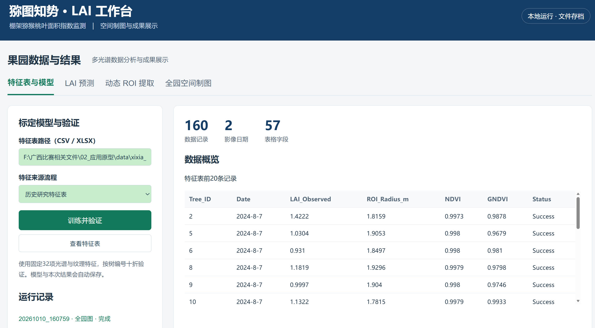
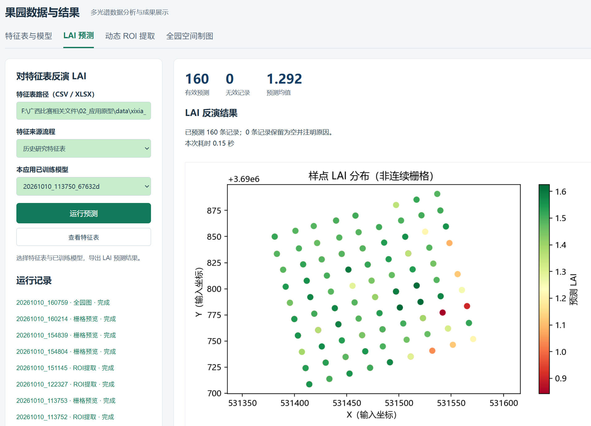
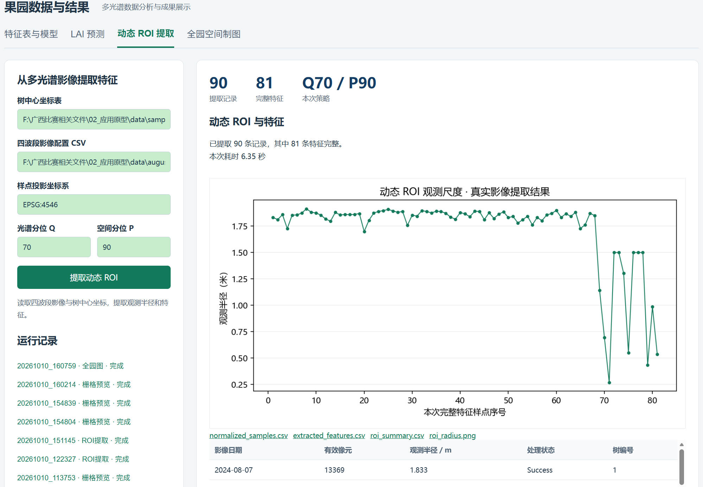
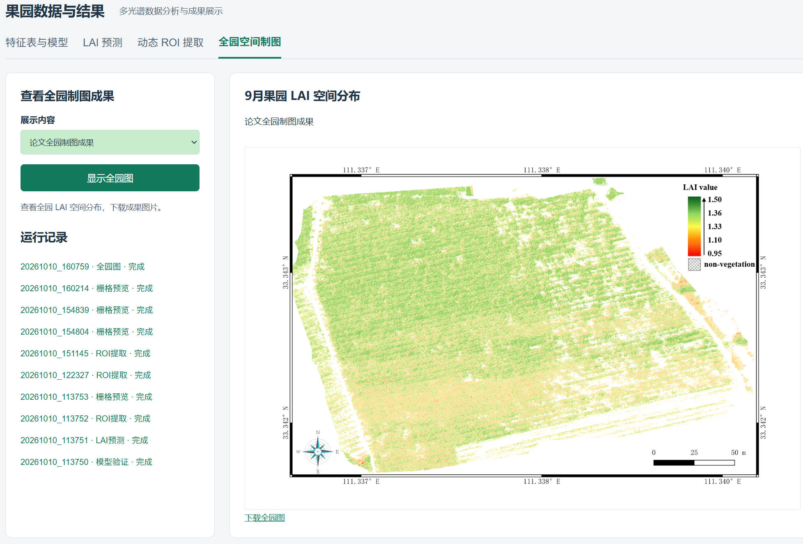

# 猕图知势 · LAI 工作台

面向棚架猕猴桃的本地 Python 应用：从无人机多光谱影像提取单株动态 ROI 特征，训练和验证叶面积指数（LAI）模型，预测样点 LAI，并查看已有空间制图成果。

应用在本机计算，通过浏览器操作，可在 Visual Studio Code 中运行。下载后即可用随包的小型示例体验主要流程，不需要下载完整果园影像，也不需要账号或在线服务。

**四个功能入口：特征表与模型、LAI 预测、动态 ROI 提取、空间成果查看。**

## 目录

- [快速开始](#快速开始)
- [软件功能与运行截图](#软件功能与运行截图)
- [用小示例跑通流程](#用小示例跑通流程)
- [准备自己的输入数据](#准备自己的输入数据)
- [参数含义与调整方法](#参数含义与调整方法)
- [输出文件与存档](#输出文件与存档)
- [目录结构](#目录结构)
- [常见问题](#常见问题)
- [方法来源与使用说明](#方法来源与使用说明)

## 快速开始

### 1. 安装依赖

下载并解压本项目，在含有 `app.py` 的项目根目录打开终端。建议使用独立 Python 环境；本包已在 Windows / Python 3.10 环境完成运行验证。

Windows PowerShell：

```powershell
python -m venv .venv
.\.venv\Scripts\python.exe -m pip install --upgrade pip
.\.venv\Scripts\python.exe -m pip install -r requirements.txt
.\.venv\Scripts\python.exe app.py
```

不必激活环境，上述命令直接使用 `.venv` 内的 Python，可避开 PowerShell 的脚本执行策略问题。安装完成后，也可双击 `start_windows.cmd` 启动。

macOS / Linux：

```bash
python3 -m venv .venv
.venv/bin/python -m pip install --upgrade pip
.venv/bin/python -m pip install -r requirements.txt
.venv/bin/python app.py
```

程序默认打开浏览器；也可以手动访问 **http://127.0.0.1:8765**。关闭终端或按 `Ctrl+C` 停止服务。

占用默认端口时，可指定其他端口：

```bash
python app.py --port 8766 --no-browser
```

此时访问 `http://127.0.0.1:8766`。服务仅监听本机 `127.0.0.1`。

### 2. 在 Visual Studio Code 中运行

1. 用 VS Code 打开本项目根目录。
2. 安装 Python、Python Debugger 扩展。
3. 通过“Python: Select Interpreter”选择刚创建的 `.venv` 环境。
4. 在终端运行 `python app.py`，或按 `F5` 选择“LAI 工作台”。

已有 Conda 环境也可以使用：选择已经安装 `requirements.txt` 中依赖的解释器，然后运行 `app.py`。项目没有绑定任何人的盘符或解释器位置。

## 软件功能与运行截图

以下为项目原始界面的运行截图。轻量版保留主要操作方式，默认数据、文件路径和部分页面文字有所调整。

### 1. 特征表与模型：查看数据、训练模型、验证精度



**用途：** 将带有参考 LAI 的特征表用于模型标定，查看数据结构和模型验证结果。

**输入：** CSV 或 XLSX 特征表，包含 `Tree_ID`、`LAI_Observed` 和指定的 32 项光谱、纹理特征。

**操作：**

1. 输入特征表路径，或点击“载入本页示例”。
2. 选择“特征来源流程”；随包数据选择“本工作台动态 ROI 提取”。
3. 点击“查看特征表”，查看记录数量、日期数量、字段数量以及前 20 条记录。
4. 如需调整模型，展开“模型参数”，设置树的数量、学习率和最大深度。
5. 点击“训练并验证”。

**计算过程：** 使用 Gradient Boosting 回归模型，以 `Tree_ID` 为分组单位执行十折交叉验证。同一株树不同日期的记录进入同一折。完成验证后，再用全部有效训练记录拟合最终模型并保存。

**结果：** 页面展示 R²、RMSE、有效记录数量及参考值—预测值散点图；存档中还有 MAE、RPD、每条记录的交叉验证预测值和残差、模型参数以及数据 SHA-256。模型保存后，自动出现在“LAI 预测”的模型下拉列表中。

训练需要**至少 10 个具有完整特征和参考 LAI 的不同树编号**。含空值、非有限特征或无效标签的记录会从训练中排除，排除数量保存在结果中。

### 2. LAI 预测：对新特征表计算叶面积指数



**用途：** 使用已标定模型计算输入记录的 LAI，生成可继续分析和制图的预测表。

**输入：** 包含相同 32 项特征的 CSV / XLSX 表，以及本应用已训练的模型。预测表不必包含 `LAI_Observed`；提供 `X`、`Y` 时可以展示样点空间分布。

**操作：**

1. 先在“特征表与模型”完成至少一次训练。
2. 切换“LAI 预测”，输入待预测特征表路径。
3. 选择与模型一致的“特征来源流程”和已训练模型。
4. 点击“运行预测”。

**结果：** 展示有效预测数、无效记录数、预测均值，并导出 `lai_predictions.csv`。原表字段保留，新增：

| 字段 | 含义 |
| --- | --- |
| `LAI_Predicted` | 模型计算的 LAI |
| `Prediction_Status` | 该记录是否具有完整有效特征 |
| `Outside_Training_LAI_Range` | 预测值是否超出训练标签的最小值—最大值范围 |

特征不完整的记录保留在输出表中，预测值为空，原因写入状态列。有 `X`、`Y` 时生成按 LAI 着色的**样点分布图**；连续 LAI 栅格通过“空间成果查看”单独打开。

“特征来源流程”是数据处理来源标记，用来检查训练和预测是否采用相同流程，选择它不会自动转换特征。自备特征表也应保持公式、辐射尺度和纹理处理方法一致。

### 3. 动态 ROI 提取：从四波段影像提取单株特征



**用途：** 根据树中心坐标，在多光谱正射影像上确定单株有效观测范围，并提取建模所需特征。

**输入：** 树中心坐标表、四波段影像配置 CSV、样点投影坐标系，以及 ROI 参数。

**操作：**

1. 填写坐标表和影像配置表路径。
2. 填写坐标表实际使用的米制投影 CRS，例如随包示例的 `EPSG:32649`。
3. 设置光谱分位 Q、空间分位 P；可展开“ROI 高级参数”调整半径和像元条件。
4. 点击“提取动态 ROI”。

**计算过程：**

1. 以树中心为锚点，建立初始探索范围。
2. 用局部 NDVI 和 NIR 的 Q 分位阈值筛选植被像元。
3. 进行形态学处理，选择中心所在或最接近中心的连通冠层。
4. 根据核心像元到中心的距离 P 分位估计观测半径，并按半径边界截断。
5. 在有效 ROI 内计算 24 项植被指数和 8 项 NIR 纹理特征。

**结果：** 页面展示提取记录数、完整特征数、Q/P 设置、观测半径曲线和前 20 条摘要。导出的特征表包括树编号、日期、坐标、参考 LAI（如果输入中有）、半径、有效像元数、状态、波段统计量和 32 项特征，可继续用于训练或预测。

输入影像具有其他有效 CRS 时，工作台通过虚拟重投影在样点米制坐标系中处理。输入同一期的四个波段必须已经配准，使用相同网格、坐标系、分辨率和范围。软件读取已完成拼接的单波段正射 GeoTIFF；原始无人机航片应先完成拼接与辐射处理。

单次可处理最多 12 个影像日期；更多日期可拆成多个配置表分批运行。当前界面输出特征表、摘要和半径曲线，不导出 ROI 矢量面。

### 4. 空间成果查看：打开 LAI 栅格或已有成果图片



**用途：** 在界面中查看已有的全园 LAI 空间分布成果，便于演示、检查和导出图件。

轻量版提供两种模式：

| 模式 | 输入 | 页面结果 |
| --- | --- | --- |
| LAI GeoTIFF 栅格预览 | 单波段 LAI `.tif` / `.tiff` | 颜色分布图、原始宽高、坐标系、预览均值，以及预览图下载 |
| 已有空间成果图片 | `.png` / `.jpg` / `.jpeg` / `.webp` | 直接展示已有制图图片，并提供副本下载 |

**操作：** 切换“空间成果查看”，选择展示内容，输入文件路径，点击“生成栅格预览”或“显示成果图片”。

GeoTIFF 模式读已有 LAI 栅格的第 1 波段。大图最长边降采样到最多 1000 像素，统计量来自预览像元，颜色范围取有效值的 2%—98% 分位；NoData 区域保留为空白。图片模式复制并展示原有图件，不改变图件内容。

截图中的地图是项目论文成果图片。随包 `lai_demo.tif` 和 `lai_demo.png` 是小型示例；本页承担**已有成果的读取和展示**，不会把输入的四波段影像自动生成连续全园 LAI 栅格。

### 5. 运行记录与结果下载

每次运行自动创建一个独立目录，记录操作类型、开始时间、输入参数、处理状态、耗时及结果文件。左侧“运行记录”可回看最近 30 次任务；重启应用后，已经完成的任务和已训练模型仍可读取。

结果区提供表格和图片下载链接。模型 `model.joblib` 保存在本地输出目录，通过模型列表用于后续预测。应用一次执行一个计算任务，处理期间等待当前任务完成即可。

## 用小示例跑通流程

### 随包示例包含什么

示例是程序生成的**合成数据**：12 个虚构树中心、2 个日期、8 幅 128 × 96 像素的四波段 GeoTIFF、24 条带标签特征，以及一幅小型 LAI 栅格。坐标、反射率和 `LAI_Observed` 均用于演示文件格式与软件流程，运行指标不代表论文研究精度。

| 文件 | 作用 |
| --- | --- |
| `examples/example_features.csv` | 24 条完整特征和参考 LAI，用于直接训练 |
| `examples/example_prediction.csv` | 第 2 期的 12 条特征，删除参考 LAI，用于体验预测 |
| `examples/sample_locations.csv` | 树编号、日期、X/Y、参考 LAI，用于影像提取 |
| `examples/imagery_config.csv` | 两期四波段文件位置 |
| `examples/imagery/*.tif` | 小型多光谱反射率影像 |
| `examples/lai_demo.tif` | 小型单波段 LAI 栅格，体验栅格预览 |
| `examples/lai_demo.png` | 对应的成果图片，体验图片展示 |

预测示例复用了训练示例中的第 2 期特征，是接口操作示例，不是独立测试集。示例 LAI 栅格独立生成，用于演示成果查看。

### 路线 A：先看界面结果

1. 启动应用，首页会自动读取 `examples/example_features.csv`。
2. 保持默认参数，点击“训练并验证”。
3. 切换“LAI 预测”，默认读入 `examples/example_prediction.csv`；选择刚生成的模型，点击“运行预测”。
4. 切换“空间成果查看”，点击“生成栅格预览”。
5. 将展示内容改为“已有空间成果图片”，保持 `examples/lai_demo.png`，点击“显示成果图片”。

### 路线 B：从多光谱影像开始

1. 切换“动态 ROI 提取”，点击“载入本页示例”。
2. 使用默认坐标表、配置表和 `EPSG:32649`，保持 Q70 / P90，点击“提取动态 ROI”。
3. 完成后找到本次 `outputs/<运行编号>/extracted_features.csv`。
4. 在“特征表与模型”输入该文件路径，选择“本工作台动态 ROI 提取”，点击“训练并验证”。
5. 用相同处理参数提取待预测样点特征，再切换“LAI 预测”并选择这次模型。

界面中的“载入本页示例”恢复当前页的示例路径和相关默认参数，不删除已有运行记录。

## 准备自己的输入数据

### 路径如何填写

- 界面和 `config.json` 中的相对路径，统一相对于**本项目根目录**，不取决于从哪个文件夹启动程序。
- 影像配置 CSV 中的波段相对路径，统一相对于**该 CSV 所在文件夹**。
- 也可输入本机绝对路径。路径框直接填路径本身，不要额外加引号。
- 建议将自己的影像和表格放在 `user_data/`；该目录和运行输出已在 `.gitignore` 中排除。文件只在本机读取，不上传到外部服务。

### 1. 树中心坐标表：CSV / XLSX

UTF-8 CSV 示例：

```csv
Tree_ID,Date,X,Y,LAI_Observed
DEMO_01,2024-08-01,400003,3800003,1.05
DEMO_02,2024-08-01,400007,3800003,1.1376
```

| 字段 | 是否必需 | 要求 |
| --- | --- | --- |
| `Tree_ID` | 是 | 树编号；同一株树不同日期使用同一编号 |
| `X`、`Y` | 是 | 树中心投影坐标，单位米，与填写的样点 CRS 对应 |
| `Date` | 否 | 推荐 `YYYY-MM-DD`；有日期时应与影像配置中的日期匹配 |
| `LAI_Observed` | 否 | 参考/实测 LAI；用于后续训练时必须有，且为非负数 |

兼容别名 `ID → Tree_ID`、`E → X`、`N → Y`。没有 `Date` 时，全部样点会对配置中的每个影像日期提取一次。

`EPSG:32649` 仅对应随包示例。自有坐标请填写实际 CRS；不能直接把经纬度放入 X/Y 后当作米制坐标。样点应位于对应影像覆盖范围内，X/Y 应分别对应东向/北向坐标。

### 2. 四波段影像配置：CSV

每行代表一个影像日期：

```csv
Date,Green,Red,RedEdge,NIR
2024-08-01,imagery/2024-08-01_green.tif,imagery/2024-08-01_red.tif,imagery/2024-08-01_rededge.tif,imagery/2024-08-01_nir.tif
```

五列均必需，列名区分大小写。四个波段分别是绿光、红光、红边和近红外。每个文件应是带有效 CRS 的**单波段 GeoTIFF**。同一期四个文件须对齐到相同网格；多波段堆叠 TIFF 请先拆分成四个文件。

优先输入已完成辐射处理的反射率产品，通常在 0—1 范围。若使用 DN 或按整数缩放的反射率，可增加以下系数列：

```csv
Date,Green,Red,RedEdge,NIR,Green_a,Green_b,Red_a,Red_b,RedEdge_a,RedEdge_b,NIR_a,NIR_b
2024-08-01,imagery/g.tif,imagery/r.tif,imagery/re.tif,imagery/nir.tif,0.0001,0,0.0001,0,0.0001,0,0.0001,0
```

每个波段用 `反射率 = a × 输入像元值 + b` 转换。上例 `0.0001` 仅适用于产品说明明确为反射率乘以 10000 的数据；原始 DN 应使用自己标定或产品规定的系数。已经是反射率时，可省略系数列，或使用 `a=1, b=0`。该转换作用于已拼接波段，不代替原始航片拼接和完整辐射处理。

### 3. 模型训练 / 预测特征表：CSV / XLSX

训练表必需：`Tree_ID`、`LAI_Observed`、以下 32 项特征。预测表必需：同名的 32 项特征；推荐保留树编号、日期和坐标。额外列会保留在输出中；列顺序不限。

24 项植被指数：

```text
NDVI, RVI, DVI, TNDVI, RDVI, NGRDI, RI, MSR,
MSAVI, TVI, WDRVI, GRVI, NLI, MTVI2, CRI, GNDVI,
OSAVI, SAVI, PVI, MCARI, RGRI, NDRE, TCARI_OSAVI, RECI
```

8 项 NIR 纹理特征：

```text
TexNIR_Contrast_Avg
TexNIR_Dissimilarity_Avg
TexNIR_Homogeneity_Avg
TexNIR_Energy_Avg
TexNIR_Correlation_Avg
TexNIR_ASM_Avg
TexNIR_Entropy_Avg
TexNIR_Mean_Avg
```

这些特征由“动态 ROI 提取”自动生成。纹理使用 32 个灰度级、1 像素距离、0° / 45° / 90° / 135° 四个方向的 GLCM，并对方向取平均；具体公式和 ROI 处理在 `reference/code/` 中。

CSV 建议 UTF-8 编码；Excel 使用第一个工作表作为数据表。特征应为有限数值，不能把 `Success` 等状态文字填进数值列。

### 4. 空间成果输入

- **栅格：** 以 LAI 为像元值的单波段 GeoTIFF，正确标记 CRS 和 NoData。
- **图片：** 已经制作好的 PNG、JPG、JPEG 或 WebP 地图。比例尺、图例和坐标等沿用原图内容。

## 参数含义与调整方法

### 动态 ROI 参数

常用 Q/P 在页面直接调整，其他参数在“ROI 高级参数”中调整。修改 `config.json` 的 `roi_defaults` 可以改变启动默认值，保存后需重启应用。

| 参数 / 字段名 | 默认值 | 含义与调整影响 |
| --- | --- | --- |
| 光谱分位 `q` | 70 | 根据局部 NDVI 和 NIR 的分位值筛选植被；提高通常更严格，降低通常保留更多像元 |
| 空间分位 `p` | 90 | 取核心像元距中心的 P 分位；提高通常保留更大的空间范围 |
| 探索半径 `exploration_radius_m` | 2.0 m | 初始搜索域；冠层更大时可增大，也会纳入更远的邻株或背景 |
| 最小半径 `r_min_m` | 0.2 m | 成功估计半径的下限 |
| 最大半径 `r_max_m` | 2.6 m | 成功估计半径的上限；实际可用像元仍受探索域限制 |
| 回退半径 `fallback_radius_m` | 1.5 m | 有核心连通冠层但核心像元太少时使用的半径 |
| 缩放系数 `alpha` | 1.0 | 对距离分位半径乘以该系数，然后应用上下限 |
| 最少核心像元 `min_valid_pixels` | 30 | 用于光谱阈值放宽及核心像元不足时的回退判断，不保证最终 ROI 至少有这么多像元 |
| 闭运算半径 `morphology_close_radius` | 2 px | 用于连接小间隙、填补小孔洞；设为 0 使用零半径结构元素 |
| 开运算半径 `morphology_open_radius` | 1 px | 用于去除小斑点；设为 0 使用零半径结构元素 |

界面范围：Q 为 0.01—99.99，P 为 0.01—100；各半径 0.01—30 m；最小半径不得超过最大半径，回退半径应处于上下限之间。核心像元数应为 1—100000 的整数，形态学半径为 0—20 的整数，alpha 为 0.01—10。

若光谱筛选像元不足，参考算法会尝试一次阈值放宽；若没有连通核心，记录提取失败状态。调整时建议先保持 Q70 / P90，只改一个参数，检查 `ROI_Radius_m`、`Pixel_Count`、`Status` 和特征完整数，再决定是否保留设置。像元分辨率变化时，30 个像元代表的面积也会变化。

用于建模时，先确定一致的提取参数和反射率处理流程。更改这些设置后，应使用新流程重新提取训练与预测特征，并重新标定模型。

### 模型参数

在“特征表与模型 → 模型参数”中调整。也可修改 `config.json` 的 `model_defaults` 并重启。

| 参数 | 默认值 | 可填范围 | 作用 |
| --- | --- | --- | --- |
| `n_estimators` | 100 | 整数 10—1000 | 提升树的数量；增大通常增加计算量和模型容量 |
| `learning_rate` | 0.05 | 0.0001—1 | 每轮更新步长；较小值通常需配合更多树 |
| `max_depth` | 3 | 整数 1—20 | 单棵树深度；增大可拟合更复杂关系，也更容易过拟合 |

随机种子固定为 42；验证固定为按 `Tree_ID` 分组的十折，特征集固定为上述 32 项。参数变化后需重新训练；页面展示的是当前参数对应的交叉验证结果。

若要比较多个参数组合，先用分组验证选择设置，再用保留的独立样本评估；训练表直接用于预测得到的是拟合结果。实际新果园应用应准备有代表性的参考 LAI 进行模型标定或独立检验。

## 输出文件与存档

输出位于 `outputs/<运行编号>/`，例如 `outputs/20261011_120000_ab12cd/`。运行编号由时间和随机后缀组成，不覆盖之前的任务。

| 功能 | 主要文件 | 内容 |
| --- | --- | --- |
| 所有任务 | `run.json` | 输入参数、状态、时间、耗时、结果列表 |
| 训练 | `model.joblib` | 最终训练模型，用于后续预测 |
| 训练 | `model_meta.json` | 特征列表、流程标记、训练范围、模型参数、数据哈希 |
| 训练 | `metrics.json` | R²、RMSE、MAE、RPD、样本和树编号数量 |
| 训练 | `validation_predictions.csv` | 各记录的十折预测值和残差 |
| 训练 | `validation.png` | 交叉验证散点图 |
| 预测 | `lai_predictions.csv` | 原表及预测值、状态、范围标记 |
| 预测 | `sample_lai.png` | 提供 X/Y 时生成的样点分布图 |
| 提取 | `normalized_samples.csv` | 日期与列名规范化后的输入坐标表 |
| 提取 | `extracted_features.csv` | 完整提取记录、波段统计量和32项特征 |
| 提取 | `roi_summary.csv` | 编号、日期、半径、有效像元和状态摘要 |
| 提取 | `roi_radius.png` | 完整特征记录的动态半径曲线 |
| 提取 | `feature_meta.json` | CRS、流程、实际 ROI 参数及输入哈希 |
| 栅格查看 | `map_preview.png`、`raster_metadata.json` | 预览图、原始尺寸与坐标系、预览统计 |
| 图片查看 | `spatial_figure.*`、`figure_source.json` | 原图副本及来源哈希 |
| 失败任务 | `error.log` | 具体错误和排查信息 |

表格和图片可从页面下载，模型保存在本地输出目录中。发布仓库时，保留 `outputs/.gitkeep` 即可；自己的运行结果和影像无需提交。

## 目录结构

```text
kiwifruit-lai-workbench/
├─ app.py                         # 本地网页与任务管理
├─ engine.py                      # 特征、训练、预测和成果查看适配层
├─ config.json                    # 示例路径和启动默认参数
├─ requirements.txt               # Python 依赖
├─ start_windows.cmd              # Windows 启动入口
├─ README.md                      # 本说明
├─ USAGE_NOTICE.md                # 原参考代码使用及专利说明
├─ CITATION.cff                   # 原方法引用信息
├─ templates/index.html           # 浏览器界面
├─ reference/code/                # 原公开 ROI 与特征算法
├─ examples/                      # 小型合成示例
│  └─ imagery/                    # 两期四波段 GeoTIFF
├─ docs/screenshots/              # 四张实际运行截图
├─ scripts/generate_examples.py   # 重建合成示例
├─ scripts/smoke_test.py           # 检查主要功能
├─ .vscode/                      # VS Code 调试配置
└─ outputs/                       # 自动存档，Git 排除
```

示例可重新生成：

```bash
python scripts/generate_examples.py
```

此命令会覆盖 `examples/` 中同名的合成示例文件。主要功能检查：

```bash
python scripts/smoke_test.py
```

检查在临时目录运行，不写入现有任务记录。

## 常见问题

**提示缺少 Python 模块。** 用运行 `app.py` 的同一个解释器执行 `python -m pip install -r requirements.txt`；VS Code 中确认选中了正确环境。

**GDAL / Rasterio 安装或加载失败。** 优先在独立 Python 环境安装依赖，避免混用不同环境的解释器和包。已有配置完整的地理分析 Conda 环境也可直接使用。

**提示缺少特征字段。** 直接使用“动态 ROI 提取”导出的特征 CSV，或检查 32 项特征的列名与大小写，不要将树坐标表直接作为训练特征表。

**全部样点提取失败。** 检查样点 CRS、X/Y 方向、影像范围和日期对应关系；查看 `extracted_features.csv` 的 `Status`。四波段需同网格，DN 输入需正确转换成反射率。

**模型和特征流程不一致。** 训练和预测两页选择相同“特征来源流程”，同时确保实际提取、反射率处理和纹理设置一致。参数变化后重新训练。

**找不到已训练模型。** 先完成一次训练；运行记录及模型保存在 `outputs/`。删除该训练目录后模型也会被移除，重启程序不会重新生成它。

**图片中的中文显示成方框。** 页面文字使用浏览器字体；计算图件需要系统中文字体。Windows 可使用微软雅黑或黑体，其他系统可安装中文字体并在 `engine.py` 的 `font.sans-serif` 中填入其字体名称。

**栅格边缘或局部为空白。** 预览遵循输入文件中的 NoData 和有效覆盖区域，不会自动填补影像缺失；需要完整地图时可直接展示已制作好的成果图片。

## 方法来源与使用说明

本工作台基于作者整理的 [kiwifruit_lai_public_code](https://github.com/2394799692/kiwifruit_lai_public_code) 中的动态 ROI 与特征提取参考实现，增加本地网页、任务管理、参数设置和小型示例。

相关论文：*Dynamic ROI-constrained UAV multispectral estimation of single-plant LAI in trellis-trained kiwifruit*，*Computers and Electronics in Agriculture*。作者和引用信息见 [CITATION.cff](CITATION.cff)。

本发布包沿用原参考代码的 [USAGE_NOTICE.md](USAGE_NOTICE.md)，保留引用要求及专利说明，未另行添加 MIT、Apache 等许可证。数据示例由程序生成，四张截图用于介绍项目界面，不包含完整实测数据集。
